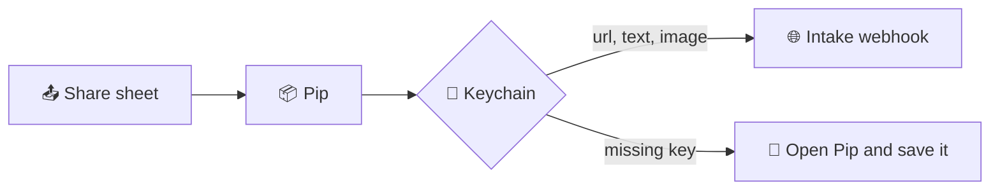

```
PPPPPPPPPPPPPPPPP   IIIIIIIIII   PPPPPPPPPPPPPPPPP
P::::::::::::::::P  I::::::::I   P::::::::::::::::P
P::::::PPPPPP:::::P I::::::::I   P::::::PPPPPP:::::P
PP:::::P     P:::::PII::::::II   PP:::::P     P:::::P
  P::::P     P:::::P  I::::I       P::::P     P:::::P
  P::::P     P:::::P  I::::I       P::::P     P:::::P
  P::::PPPPPP:::::P   I::::I       P::::PPPPPP:::::P
  P:::::::::::::PP    I::::I       P:::::::::::::PP
  P::::PPPPPPPPP      I::::I       P::::PPPPPPPPP
  P::::P              I::::I       P::::P
  P::::P              I::::I       P::::P
  P::::P              I::::I       P::::P
PP::::::PP          II::::::II   PP::::::PP
P::::::::P          I::::::::I   P::::::::P
P::::::::P          I::::::::I   P::::::::P
PPPPPPPPPP          IIIIIIIIII   PPPPPPPPPP
```

*Pip is a tiny courier that carries links, text, and images to pip.*

Hand it a link, a scrap of text, a photo, or a file. Add a note if you feel like it. Pip tucks the parcel into your personal intake webhook and gets out of the way.

<!-- BEGIN KIT-MANAGED README BADGES -->
[](https://github.com/jamesonstone/pip/commits) [](https://github.com/jamesonstone/pip/issues) [](https://github.com/jamesonstone/pip/pulls) [](https://github.com/jamesonstone/pip/releases)
<!-- END KIT-MANAGED README BADGES -->

[](https://developer.apple.com/macos/)
[](https://developer.apple.com/ios/)
[](https://swift.org)
[](https://github.com/jamesonstone/pip/actions/workflows/ci.yml)
[](LICENSE)

## ✨ What you get

A native SwiftUI app for Mac and iPhone, plus a share extension named **Pip**. It shows up in the system share sheet. You move it to the top yourself. Pip cannot do that part. Apple keeps the seat map.

The webhook URL and the key stay in the Keychain. They are not in this repo, and they should never be.

## 🗺️ How a share travels



Pip POSTs JSON. The header is `Authorization: Bearer <key>`. The body can carry:

| Field | What Pip puts there |
| --- | --- |
| `url` | The link, or the shared text when there is no link |
| `text` | Your optional note |
| `image` | Base64 bytes. Photos are scaled down and sent as JPEG |
| `filename` | The attachment name |
| `type` | The MIME type |
| `source` | `ios` or `macos` |

## 🧭 Emoji legend

| Mark | Meaning |
| --- | --- |
| 📬 | Delivered |
| 🩹 | The send failed. Try again |
| 🔑 | The webhook is not saved yet |
| 📦 | The attachment is over the size cap |
| 🔐 | The URL and key are in the Keychain |

## 🛠️ Set it up

You need a Mac with Xcode 16 or newer, and an Apple ID that can sign onto your iPhone. The steps below use placeholder values on purpose. Put your own Team ID, bundle prefix, webhook URL, and key only on your machine.

### 1. Signing

```bash
brew install xcodegen
cp Config/Signing.xcconfig.example Config/Signing.xcconfig
```

Edit `Config/Signing.xcconfig`:

- `DEVELOPMENT_TEAM` is the 10-character Team ID. In Xcode: Signing & Capabilities, or [developer.apple.com/account](https://developer.apple.com/account) under Membership.
- `PRODUCT_BUNDLE_IDENTIFIER_PREFIX` is a prefix you control, such as `com.yourname`. Leave the example value only if you are just looking.

Then:

```bash
xcodegen generate
open Pip.xcodeproj
```

In the project navigator, select the **Pip** target, then the **PipShare** target. For each one, open Signing & Capabilities and confirm:

- Automatically manage signing is on.
- Your team is selected.
- Do this once with the run destination set to My Mac, and once with your iPhone selected, so both platforms get a profile.

The entitlements already request Keychain Sharing for `$(TeamID).<prefix>.pip.shared`. The first build with automatic signing registers that group. If Xcode asks to enable the capability, allow it.

`Config/Signing.xcconfig` is gitignored. Do not commit it. Do not paste the webhook key into the project, the plist, or this README.

### 2. First run

1. Choose the Pip scheme. Run it on My Mac, then on your iPhone.
2. In the app, paste the intake webhook URL. It has to be `https`.
3. Paste the bearer key.
4. Tap **Save**. The line you want is "Tucked in the Keychain 🔐".

The share extension reads that same Keychain item. You do not enter the key again inside the sheet.

### 3. Mac share sheet

1. Open Safari, Photos, or Finder and share something.
2. In the share sheet, choose **Edit Extensions…** (it sits at the bottom of the menu). You can also use System Settings → Privacy & Security → Extensions → Sharing.
3. Turn **Pip** on.
4. Drag Pip to the top of the list so it sits in the top row.
5. Close the editor. Share a link. You should see a short note field and **Send**.

### 4. iPhone share sheet

1. The Pip app from step 2 has to be installed on the phone. A simulator build will not appear in the share sheet of your real phone.
2. In Safari, Photos, or Files, tap Share.
3. Scroll the app row and tap **More**, or tap **Edit Actions** / the edit control at the end of the row.
4. Find **Pip**, turn it on, and drag it to the top of the favorites so it shows in the first row.
5. Tap Done. Share a photo or a link to confirm the sheet opens.

Success says **Delivered! 📬**. A problem says **Pip tripped, try again 🩹**. If the key was never saved, Pip says to set the webhook first.

## 🧪 Tests

On a Mac, from the repo root, after the signing file from step 1 exists:

```bash
make test
make build-ios
make build-macos
```

`make test` runs the PipCore package tests: payload shape, the Keychain wrapper, image compression, and the webhook request. The build targets compile without a signing identity. CI does the same on a macOS runner. None of that needs your webhook.

## 🤫 Secrets

This repository is public. The intake URL, the bearer key, the Team ID, and your real bundle prefix do not belong in git. The example xcconfig uses `com.example` and an empty team on purpose.

## Maintainers

Maintained by [jamesonstone](https://github.com/jamesonstone).
